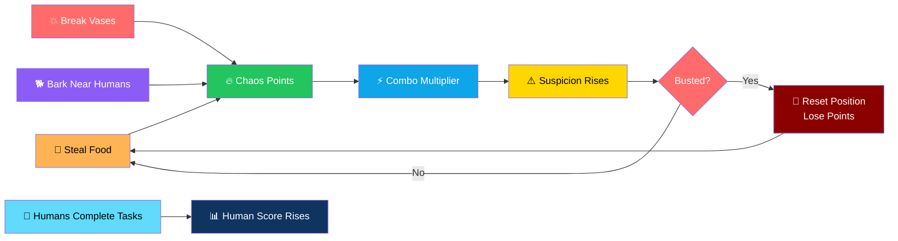
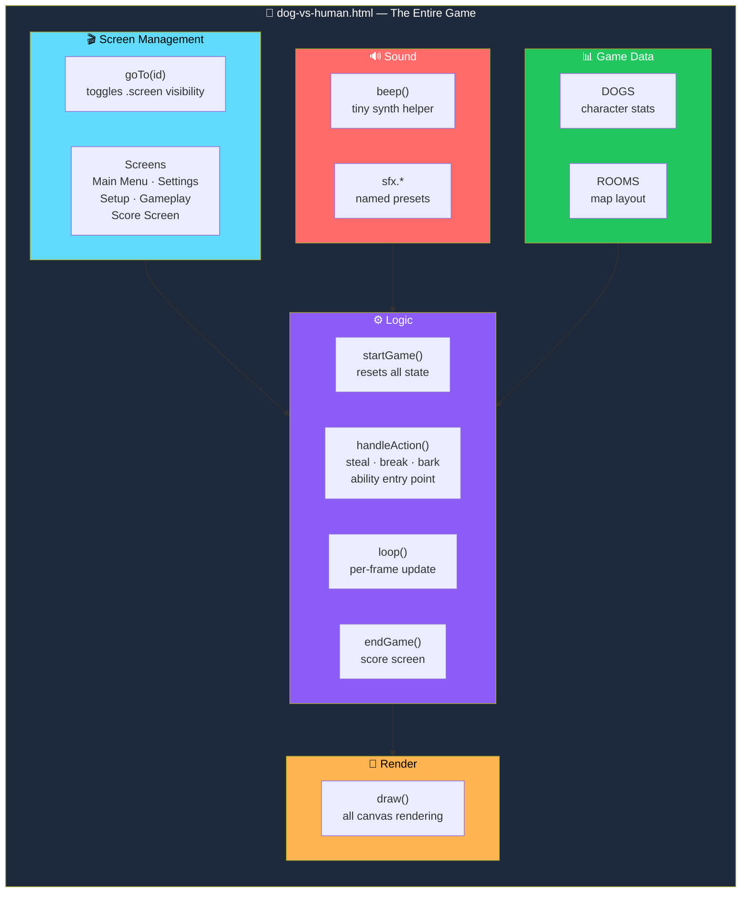
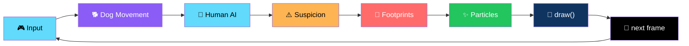

# 🐕 DOG vs HUMAN — Party Game (v1.0)

**An asymmetric party game where chaos is the win condition.**

*You play the dog. Two AI humans have chores. Only one of you gets what they want.*

[🎮 How to Run](#-how-to-run) • [🕹️ Controls](#-controls) • [🎯 Core Loop](#-core-loop) • [✨ What's Included](#-whats-included-in-this-build) • [🏗️ Architecture](#️-architecture)

---

## 📖 Overview

**DOG vs HUMAN** is a **single-player prototype of the asymmetric party game**.

You play a **mischievous dog** trying to maximize chaos — while **two AI-controlled humans** try to finish their chores and catch you.

### Core Idea

> **The dog's job is to make a mess. The humans' job is to clean it up.**
>
> Every action you take raises suspicion. Every task they complete is a point they win. Two minutes. See who comes out ahead.

### The Loop

---

## 🎮 How to Run

1. **Unzip this folder**
2. **Double-click `dog-vs-human.html`** — or open it in any modern browser:
   - Chrome · Safari · Firefox · Edge
3. **Play fullscreen** for the best experience

> ✅ **Works on desktop** *(keyboard)* **and mobile/tablet** *(on-screen touch controls appear automatically)*.

> 💡 **No build step, no dependencies to install, no internet connection required.**
>
> The only external resource is the Google Font **"Baloo 2"** — if you're offline, the game falls back to a system font automatically.

---

## 🕹️ Controls

| Action | Keyboard | Touch |
|--------|----------|-------|
| **Move** | Arrow keys / WASD | D-pad *(bottom-left)* |
| **Act** *(steal food / knock over / bark)* | `Space` | "Act" button |
| **Speed Burst** | `Shift` | "Burst" button |
| **Fake Sleep** *(become hard to notice)* | `X` | "Sleep" button |

---

## 🎯 Core Loop

| 🔥 Chaos Meter | ⚠️ Suspicion |
|:---:|:---:|
| Earn points by stealing food, breaking vases/furniture, and barking near humans. Chain actions quickly to build a combo multiplier — **"CHAOS COMBO x3!"** pops up when you're on a streak | Each human has a suspicion bar that rises when they're near you *(and you're not hidden)* or near fresh footprints. At **100%** you get **"BUSTED"** — you're teleported back to a start point, lose some chaos points, and your combo resets |
| **👣 Footprints** | **✅ Tasks** |
| Moving leaves a fading trail that raises suspicion if a human walks near it. **Fake Sleep** also hides you from detection briefly | Humans wander to random spots in the house and slowly complete a task *(progress bar + label)*. Every finished task adds to the **Human Task Score** |
| **⏱️ Match Length** | **📊 Score Screen** |
| **120 seconds** | Dog Chaos Score · Human Task Score · Most food stolen · Objects destroyed · Longest chase · Most suspicious moment |

### Detailed Mechanics

#### 🔥 Chaos Meter

Earn points by:

- **Stealing food**
- **Breaking vases and furniture**
- **Barking near humans**

> 💡 **Chain actions quickly to build a combo multiplier** — "CHAOS COMBO x3!" pops up when you're on a streak.

#### ⚠️ Suspicion

- Each human has a **suspicion bar**
- Rises when they're **near you** *(and you're not hidden)*
- Rises when they're **near fresh footprints**
- At **100%** → **"BUSTED"**
  - You're teleported back to a start point
  - You lose some chaos points
  - Your combo resets

#### 👣 Footprints

- Moving leaves a **fading trail**
- Raises suspicion if a human walks near it
- **Fake Sleep** also hides you from detection briefly

#### ✅ Tasks

- Humans wander to random spots in the house
- Slowly complete a task *(progress bar + label)*
- **Every finished task adds to the Human Task Score**

#### ⏱️ Match Length

**120 seconds.** At the end you get a score screen with:

| Stat | What It Measures |
|------|-----------------|
| **Dog Chaos Score** | Your performance |
| **Human Task Score** | Chores finished |
| **Most Food Stolen** | Your appetite for crime |
| **Objects Destroyed** | Your collateral damage |
| **Longest Chase** | Your most dramatic escape |
| **Most Suspicious Moment** | Peak suspicion reached |

---

## ✨ What's Included in This Build

| 🎬 Full Menu Flow | 🗺️ One Playable Map |
|:---:|:---:|
| Main Menu → Settings → Setup → Gameplay → Score Screen → Restart | **House** — Kitchen / Living Room / Bedroom |
| **🍖 Stealable Food** | **💥 Breakable Props** |
| Scattered around the house | Vase and chair |
| **👥 Two AI Humans** | **🐕 Three Dog Characters** |
| Independent tasks and suspicion | **Scrappy Pup** *(balanced)* · **Lazy Hound** *(slow but steady)* · **Zoomie Terrier** *(fast)* |
| **⚡ Two Dog Abilities** | **🔊 Procedural Audio** |
| Speed Burst · Fake Sleep *(each on its own cooldown)* | Bark · steal · crash · busted · victory jingle — synthesized via Web Audio API · volume adjustable in Settings |
| **🎨 Illustrated UI** | **📱 Fully Responsive** |
| Gradient sky · drifting clouds · paw print decorations · hand-drawn-feel palette · chunky rounded Baloo 2 typeface with outlines and drop-shadow | Playable on phones/tablets via on-screen touch controls · canvas resizes to fit the window |

### 🗺️ The Map

**House** — with three areas:

- 🍳 **Kitchen** — food to steal
- 🛋️ **Living Room** — breakables to knock over
- 🛏️ **Bedroom** — the humans' domain

### 🐕 The Dogs

| Dog | Profile |
|-----|---------|
| **Scrappy Pup** | Balanced — good at everything |
| **Lazy Hound** | Slow but steady — conserves energy |
| **Zoomie Terrier** | Fast — high speed, low control |

### ⚡ Abilities

| Ability | Effect |
|---------|--------|
| **Speed Burst** | A short, fast sprint |
| **Fake Sleep** | Become hard to notice for a short time |

> 💡 **Each ability has its own cooldown.**

### 🔊 Audio

**All sounds synthesized live with Web Audio API** — **no audio files needed**:

- 🐕 Bark
- 🍖 Steal
- 💥 Crash
- 🚨 Busted
- 🎉 Victory jingle

**Volume is adjustable in Settings.**

### 🎨 The Look

- **Gradient sky**
- **Drifting cloud shapes**
- **Paw print decorations**
- **Hand-drawn-feel color palette**
- **Chunky rounded typeface** *(Baloo 2)* with thick outlines and drop-shadow text
- A **playful, "kids' cartoon" tone** throughout

---

## 🚧 What's Stubbed for a Future Pass

> **This build focuses on a fully playable core experience.**

| Feature | Current State |
|---------|--------------|
| **Apartment · Backyard · Restaurant · Office · School maps** | Visible *(but disabled)* in the map-select screen as a preview of what's coming |
| **Dog abilities** — Super Bark · Invisible · Mega Jump · Food Radar | Designed for but not yet wired in |
| **Human tools** — Vacuum · Flashlight · Food Lure · Toy · Net · Security Camera | Designed for but not yet wired in |

> 💡 **Rather than ship a fake button, we disabled the map and left the abilities in the design doc.**

---

## 🏗️ Architecture

### Everything in One File

### The Main Loop

### Code Structure — For Extending It

Everything lives in **one self-contained file** — `dog-vs-human.html` — organized into **clearly separated sections**:

| Section | Purpose |
|---------|---------|
| **Screen management** | A simple `goTo(id)` function toggles which `.screen` div is visible. Add a new screen by adding `
` and wiring a button to `goTo()` |
| **Sound** | `beep()` is a tiny synth helper; `sfx.*` are named presets. Add a new sound by adding one more `sfx.yourName = () => beep(...)` |
| **Game data** | `DOGS` *(character stats)* and `ROOMS` *(map layout)* are plain data objects. A new map is just a new array of room rectangles plus a new `objects` layout — the collision, drawing, and task logic already read from these generically |
| **`startGame()`** | Resets all state for a match — dog, humans, objects, stats, timer |
| **`handleAction()`** | The dog's **"Act"** button logic *(steal / break / bark)* — **this is the natural place to add new abilities** |
| **`loop()`** | The main per-frame update — dog movement, human AI, suspicion, footprints, particles, then `draw()` |
| **`draw()`** | All canvas rendering, kept separate from game logic so you can restyle visuals without touching rules |
| **`endGame()`** | Computes and displays the score screen |

### 🗺️ Adding a New Map

1. Add a new entry to the **map-select buttons** *(remove `disabled`)*
2. Define a **`ROOMS`-style layout** and an `objects` array for it
3. In **`startGame()`**, branch on the selected map to load the right layout

### ⚡ Adding a New Ability

1. Add a **cooldown / timer field** to the `dog` object in `startGame()`
2. Handle the **key / button** in `handleAction()` or `loop()`
3. Draw any **visual feedback** in `draw()`

### 🌐 Multiplayer Note

> **This build simulates both sides with AI so the core loop can be tested solo.**
>
> Because game state — `dog`, `humans`, `objects`, `chaos`, timers — is already **centralized in a handful of plain objects updated once per frame in `loop()`**, it's straightforward to later:
>
> - **Swap the human AI for real player input**
> - **Sync `dog`/`humans`/`objects` over a network layer** *(e.g. WebRTC or WebSockets)*
>
> …**without restructuring the rendering or rules code.**

### Design Principles

| Principle | Implementation |
|-----------|---------------|
| **📄 One file, zero dependencies** | The whole game is one HTML file — no build step, works offline |
| **🎮 Two input sources, one ruleset** | Keyboard and touch both feed the same actions — mobile controls appear automatically |
| **📊 Content is data** | `DOGS` and `ROOMS` are plain objects — new maps and dogs are additions, not rewrites |
| **🎨 Rendering is separate from rules** | `draw()` reads game state; it never mutates it. Restyle visuals without touching gameplay |
| **🧠 Multiplayer-ready state** | State is centralized in a few plain objects updated once per frame — the seam for real multiplayer |
| **🚫 No fake buttons** | Stubbed maps are disabled, stubbed abilities are left in the design doc |
| **🎨 Illustrated by design** | Gradient sky, drifting clouds, paw prints, outlines, and drop-shadows — a "kids' cartoon" feel, not a wireframe |

---

## ⚠️ Known Limitations

| Limitation | Details |
|-----------|---------|
| **Single map** | Only **House** in this build |
| **No persistent high scores** | Nothing is saved between sessions |
| **Sound is synthesized** | Chiptune-style beeps, **not recorded audio** |

---

## 🗺️ Roadmap

### ✅ Current

- [x] Full menu flow — Main Menu → Settings → Setup → Gameplay → Score Screen → Restart
- [x] One fully playable map — **House** *(Kitchen / Living Room / Bedroom)*
- [x] Stealable food and breakable props
- [x] Two AI humans with independent tasks and suspicion
- [x] Three dog characters with different speed profiles
- [x] Two dog abilities — Speed Burst and Fake Sleep *(with cooldowns)*
- [x] Chaos Meter with combo multipliers
- [x] Suspicion system with BUSTED penalty
- [x] Footprint trail that raises suspicion
- [x] 120-second match with full score screen
- [x] Procedural Web Audio sound effects
- [x] Volume control in Settings
- [x] Illustrated, cartoon-styled UI
- [x] Fully responsive with on-screen touch controls
- [x] Single-file, zero-dependency, works offline

### 🔜 Future Ideas

- [ ] **Apartment, Backyard, Restaurant, Office, School maps** — already shown in map-select
- [ ] **Dog abilities** — Super Bark, Invisible, Mega Jump, Food Radar
- [ ] **Human tools** — Vacuum, Flashlight, Food Lure, Toy, Net, Security Camera
- [ ] **Persistent high scores** — across sessions
- [ ] **Local 2-player** — swap AI for a second keyboard
- [ ] **Online multiplayer** — WebRTC or WebSockets
- [ ] **More dog characters** with unique abilities
- [ ] **Daily challenge** with a fixed seed

---

## 🤝 Contributing

Contributions are welcome. Please:

1. Fork the repository
2. **Keep it single-file** — no external build step, no bundler
3. **Keep it asset-free** — no image files, no audio files
4. **Keep `draw()` pure** — it reads state, never mutates it
5. **Add new maps through `ROOMS`** — data, not code
6. **Add new abilities through `handleAction()` and `loop()`** — the established pattern
7. Test on both desktop and mobile
8. Submit a Pull Request

### Guidelines

- **Never add a required external dependency** beyond the Google Font
- **Never require a build step** — `dog-vs-human.html` and nothing else
- **Never break keyboard OR touch controls** — both must work
- **Never re-enable a stubbed map** until it's actually playable
- **Never present a stub as a feature** — the **What's Stubbed** section is the standard

---

## 📜 License

MIT — see [LICENSE](LICENSE) for details.

---

## 🙏 Acknowledgments

- **Canvas 2D** — for making a full party game possible in one file
- **Web Audio API** — for a game with zero audio files
- **Every dog who's ever knocked something off a table while maintaining eye contact** — this one's for you

---

### 🐕 STEAL. BREAK. BARK. CHAOS.

**You play the dog. Two AI humans have chores.**

**Only one of you gets what they want.**

 

### Enjoy the chaos! 🐾

 

⭐ If you enjoyed this game, consider giving it a star.

 

[⬆ Back to Top](#-dog-vs-human--party-game-v10)

